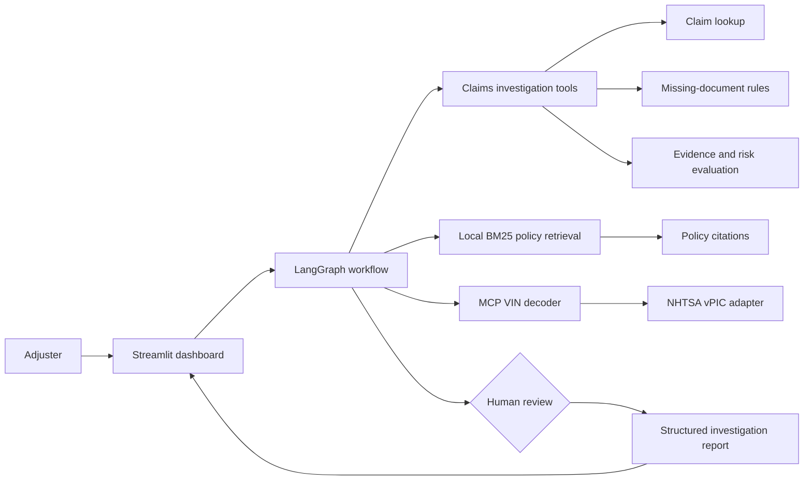

# AIClaimsAssist — Agentic Claims Investigation Assistant

The Gen Academy, Mastering Agentic AI, Week 3 project.

AIClaimsAssist is a synthetic claims-investigation prototype for insurance adjusters. It organizes claim details, policy evidence, missing documents and potential inconsistencies so a human can review the findings. It does not approve, deny or settle claims.

## Problem statement

Claims adjusters spend time reviewing policies, evidence, missing documents and inconsistent claim information. This project demonstrates a read-only assistant that gathers those findings into a structured, citation-backed investigation report for human review.

## Solution capabilities

- 20 synthetic Motor and Auto claims
- Claim lookup with related notes, documents and evidence
- Configurable missing-document identification
- Neutral evidence-indicator evaluation
- Deterministic, explainable investigation-priority score from confirmed discrepancies
- Local BM25 policy retrieval with policy-isolated citations
- MCP-based VIN verification workflow with safe failure handling
- LangGraph investigation workflow
- Human-in-the-loop review with `ACCEPT_REPORT` and `REQUEST_MORE_INFO`
- Four-part structured investigation report
- Streamlit dashboard with Fraud, Missing documents and Report tabs

## Architecture



## Technology stack

- Python 3.11
- LangChain 1.4.10
- LangChain Core 1.7.7
- LangGraph 1.2.20
- MCP SDK 2.3.0
- Streamlit 1.67.0
- OpenAI-compatible SDK 3.49.0
- pytest 9.2.0
- Existing Week 2 document extraction and retrieval components
- Local BM25 retrieval over the approved Week 3 policy chunks

## Project structure

| Path | Purpose |
|---|---|
| `app.py` | Streamlit dashboard |
| `claims_agent.py` | LangGraph investigation workflow and review checkpoint |
| `claim_lookup.py` | Read-only claim lookup |
| `missing_documents.py` | Synthetic document-requirement evaluation |
| `fraud_indicators.py` | Evidence observation organization |
| `fraud_risk.py` | Deterministic investigation-priority score |
| `policy_loader.py` | Manifest-only policy document loading |
| `policy_search.py` | Policy-isolated local BM25 search |
| `mcp_server.py` | Local MCP VIN tool server |
| `vin_decoder.py` | NHTSA vPIC response adapter |
| `vehicle_verification.py` | Reported-versus-decoded vehicle comparison |
| `investigation_report.py` | Structured report builder |
| `data/claims/` | 20 synthetic claims and related records |
| `data/policies/` | Synthetic Week 3 Auto policy documents |
| `data/policy_registry.json` | Eligible policy metadata and document references |
| `tests/` | Offline regression tests |
| `Week2_AIClaimsAssist_RAG/` | Existing Week 2 project preserved as a Git submodule |

## Local setup

The repository expects Python 3.11. Clone the repository with its Week 2 submodule:

```powershell
git clone --recurse-submodules https://github.com/shilpasrihari-cmd/Week3-AIClaimsAssist_AgenticClaimsInvestigation.git
cd Week3-AIClaimsAssist_AgenticClaimsInvestigation
python -m venv .venv
.\.venv\Scripts\Activate.ps1
```

The validated environment contains these package families:

```powershell
python -m pip install streamlit langchain langchain-core langgraph mcp openai pytest python-dotenv PyMuPDF python-docx langchain-text-splitters tiktoken truststore rank-bm25 openpyxl
```

The current dashboard and offline tests use synthetic data and mocked external responses. No credentials are required for those workflows. Optional external scripts use environment variable names such as:

```text
NEBIUS_API_KEY=
NEBIUS_BASE_URL=
LLM_MODEL=
PINECONE_API_KEY=
PINECONE_INDEX_NAME=
EMBEDDING_MODEL=
```

Never commit values for these variables. The local `.env` file is excluded by `.gitignore`.

## Run the dashboard

```powershell
\.venv\Scripts\python.exe -m streamlit run app.py
```

Then select a claim in the sidebar and choose **Run Investigation**.

## Run tests

```powershell
\.venv\Scripts\python.exe -m pytest tests -q
```

The tests are offline. They mock MCP/NHTSA responses and do not upload embeddings or call Pinecone.

## Demonstration workflow

1. Select one of the 20 synthetic claims.
2. Run the investigation.
3. Review the Fraud tab for evidence observations and the investigation-priority score.
4. Review missing required and conditional documents.
5. Examine policy citations and vehicle verification in the Report tab.
6. Use the human-review radio option to accept findings for reporting or request more information.

The review decision applies to the investigation report only. It is not an insurance claim decision.

## Validation results

Step 14A final validation reported:

- 83 automated tests passed
- 20/20 synthetic claims investigated offline
- 20/20 investigations paused for human review
- Zero policy-isolation failures
- Both human-review decisions tested successfully
- Investigation findings remained unchanged during resume
- No tools reran during resume
- Streamlit tabs and review controls were detected with `AppTest`
- No claim records were modified

## Known limitations

- The workflow is deterministic; it does not use LLM-directed tool selection.
- Retrieval is local BM25 over approved policy chunks, not a complete Pinecone-backed Hybrid RAG deployment.
- Live NHTSA verification was not validated in the final offline run; MCP decoder responses were mocked.
- Human-review state uses an in-memory LangGraph checkpoint and is lost when the process stops.
- Review notes are not required in this accepted prototype.
- Claims, policy documents, evidence and document inventories are synthetic training data.
- Streamlit test runs may emit non-fatal dataframe compatibility/deprecation messages with the installed Streamlit version.

## Safety and privacy

- Synthetic data only; no real policyholder or claim information is intended.
- The assistant does not autonomously approve, deny or settle claims.
- The risk score is an investigation-priority indicator, not a fraud probability or proof of fraud.
- Missing documents, unsupported VINs and API failures do not independently create fraud risk.
- Human review is required before findings are treated as ready for reporting.
- Keep API keys and other credentials in local environment variables and never commit them.
